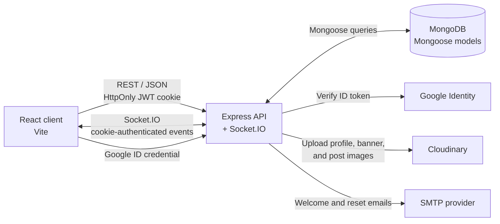

# ProConnect

## 1. About ProConnect

ProConnect is a professional networking platform where people can showcase their experience, build meaningful connections, share industry updates, and collaborate on projects. With professional profiles, a social feed, real-time messaging, and a dedicated collaboration space, it brings networking and teamwork together in one place.

**Connect professionally. Share knowledge. Build together.**

**Developer:** Chetna Singh

**Live app:** [ProConnect](https://proconnect-livid.vercel.app/login)

**Source code:** [GitHub repository](https://github.com/chetu300/ProConnect)

[](https://react.dev/)
[](https://vite.dev/)
[](https://tailwindcss.com/)
[](https://expressjs.com/)
[](https://mongoosejs.com/)
[](https://socket.io/)
[](./LICENSE)

## 2. Overview & Key Features

ProConnect is a full-stack MERN application that combines a professional profile and social feed with networking, messaging, and project collaboration. The frontend is a React single-page app; the backend exposes a versioned Express API backed by MongoDB and Mongoose.

- **Authentication:** email/password signup and login, Google Sign-In, JWT sessions in an HttpOnly cookie, and logout. The login page does not currently offer a password-reset link.
- **Professional profiles:** editable headline, bio, skills, experience, education, and projects; profile and banner image uploads; client-generated PDF resume.
- **Network:** suggested people, connection requests, and accept/reject flows.
- **Social feed:** paginated posts with text and optional Cloudinary-hosted images, likes, and comments.
- **Messaging:** REST message history and delivery, with Socket.IO events for new messages; messaging is limited to accepted connections.
- **Notifications:** persisted notifications for connection activity, likes, comments, and messages, with real-time delivery and navigation dots for new messages and notifications.
- **Build With Me:** create collaboration projects, request to join, review requests, and update project status.
- **Email:** Nodemailer SMTP integration for welcome and password-reset emails.

## 3. System Architecture



The API is mounted at `/api/v1`. The Express HTTP server and Socket.IO server share the backend process. The client sends the JWT cookie with credentialed requests; the backend validates it for protected REST routes and Socket.IO connections.

## 4. Database Schema & Relationships

All records use MongoDB ObjectIds. The following are the Mongoose models; MongoDB collection names use Mongoose's default pluralization.

| Model / collection | Key fields | Relationships and notes |
| --- | --- | --- |
| `User` / `users` | `name`, unique `username`, unique `email`, `password`, `headline`, `about`, `skills`, `profileImage`, `bannerImage`, timestamps | `experience`, `education`, and `projects` are embedded profile subdocuments. Password-reset token and expiry fields are excluded from normal query selection. |
| `Post` / `posts` | `text`, `image`, timestamps | `author` references `User`; `likes` is an array of `User` references; `comments` are embedded subdocuments with a `User` reference and timestamps. |
| `Connection` / `connections` | `sender`, `receiver`, `status` (`pending`, `accepted`, `rejected`), timestamps | `sender` and `receiver` reference `User`. |
| `Message` / `messages` | `sender`, `receiver`, `text`, `isRead`, timestamps | Both participants reference `User`. |
| `Notification` / `notifications` | `recipient`, `sender`, `type`, `message`, `relatedPost`, `isRead`, timestamps | `recipient` and `sender` reference `User`; optional `relatedPost` references `Post`. |
| `TeamProject` / `teamprojects` | `title`, `description`, `rolesNeeded`, `skills`, `status`, timestamps | `owner` and `teamMembers` reference `User`; join requests are embedded subdocuments with a `User` reference and status. |

`TeamProject.status` is `idea`, `building`, or `launched`; join requests use `pending`, `accepted`, or `declined`. `Notification.type` is `connection`, `like`, `comment`, or `message`.

## 5. Folder Structure

```text
ProConnect/
├── backend/
│   ├── config/                 # MongoDB, Cloudinary, SMTP, Socket.IO, env loading
│   ├── controllers/
│   │   ├── auth/
│   │   ├── connection/
│   │   ├── message/
│   │   ├── notification/
│   │   ├── post/
│   │   ├── teamup/
│   │   └── user/
│   ├── middleware/             # JWT cookie authentication
│   ├── models/                  # Mongoose schemas
│   ├── routes/                  # Express route modules
│   ├── utils/                   # JWT, email templates, notifications
│   ├── .env.example
│   ├── server.js
│   └── package.json
├── frontend/
│   ├── src/
│   │   ├── assets/
│   │   ├── components/
│   │   │   ├── chat/
│   │   │   ├── layout/
│   │   │   ├── network/
│   │   │   ├── post/
│   │   │   └── profile/
│   │   ├── context/             # Auth and Socket.IO providers
│   │   ├── lib/                 # Axios client
│   │   ├── pages/
│   │   ├── utils/               # Resume PDF generation
│   │   ├── App.jsx
│   │   ├── main.jsx
│   │   └── styles.css
│   ├── index.html
│   ├── vite.config.js
│   └── package.json
└── .gitignore
```

## 6. API Endpoints Reference

All endpoints are prefixed with `/api/v1`. Protected endpoints require a valid JWT in the `token` HttpOnly cookie.

| Method | Endpoint | Auth required | Description |
| --- | --- | :---: | --- |
| `GET` | `/api/v1/health` | No | API health check. |
| `POST` | `/api/v1/auth/signup` | No | Create an account and start a session. |
| `POST` | `/api/v1/auth/login` | No | Validate credentials and start a session. |
| `POST` | `/api/v1/auth/google` | No | Verify a Google ID credential and start a session. |
| `POST` | `/api/v1/auth/forgot-password` | No | Request a password-reset email. |
| `POST` | `/api/v1/auth/reset-password` | No | Set a new password using a valid reset token. |
| `POST` | `/api/v1/auth/logout` | No | Clear the session cookie. |
| `GET` | `/api/v1/auth/me` | Yes | Return the authenticated user's profile. |
| `GET` | `/api/v1/users/suggestions` | Yes | List suggested users not already connected or in a connection request. |
| `GET` | `/api/v1/users/:username` | Yes | Fetch a profile by username. |
| `PATCH` | `/api/v1/users/me` | Yes | Update the current user's profile and upload profile/banner images. |
| `GET` | `/api/v1/posts` | Yes | Fetch a feed page (20 posts per page; `page` query parameter). |
| `POST` | `/api/v1/posts` | Yes | Create a text and/or image post. |
| `POST` | `/api/v1/posts/:postId/like` | Yes | Toggle the authenticated user's like on a post. |
| `POST` | `/api/v1/posts/:postId/comments` | Yes | Add a comment to a post. |
| `DELETE` | `/api/v1/posts/:postId` | Yes | Delete a post owned by the authenticated user. |
| `GET` | `/api/v1/connections` | Yes | List accepted connections and sent/received pending requests. |
| `POST` | `/api/v1/connections/:userId/request` | Yes | Send a connection request. |
| `PATCH` | `/api/v1/connections/:requestId/accept` | Yes | Accept a received pending request. |
| `PATCH` | `/api/v1/connections/:requestId/reject` | Yes | Reject a received pending request. |
| `GET` | `/api/v1/messages/:userId` | Yes | Fetch the latest 100 messages with an accepted connection. |
| `POST` | `/api/v1/messages/:userId` | Yes | Send a message to an accepted connection. |
| `GET` | `/api/v1/notifications` | Yes | Fetch the latest 50 notifications for the current user. |
| `PATCH` | `/api/v1/notifications/:notificationId/read` | Yes | Mark one of the current user's notifications as read. |
| `GET` | `/api/v1/team-projects` | Yes | List collaboration projects. |
| `POST` | `/api/v1/team-projects` | Yes | Create a collaboration project. |
| `POST` | `/api/v1/team-projects/:projectId/requests` | Yes | Request to join a project. |
| `PATCH` | `/api/v1/team-projects/:projectId/status` | Yes | Update a project status (owner only). |
| `PATCH` | `/api/v1/team-projects/:projectId/requests/:requestId` | Yes | Accept or decline a join request (owner only). |

The authenticated Socket.IO connection uses the same cookie. The backend emits `newMessage` and `newNotification` events to the recipient's user room.

## 7. Environment Variables

Copy `backend/.env.example` to `backend/.env`. The backend loads that file directly, and Vite is configured to read frontend `VITE_` variables from the same directory. Replace placeholders locally; do not commit real credentials.

| Variable | Used by | Description | Example |
| --- | --- | --- | --- |
| `PORT` | Backend | Express/Socket.IO listening port. Defaults to `5000` in code. | `5001` |
| `MONGO_URI` | Backend | MongoDB connection string. | `mongodb://127.0.0.1:27017/proconnect` |
| `JWT_SECRET` | Backend | Secret used to sign and verify session JWTs. Use a long, unique random value. | `replace-with-a-long-random-secret` |
| `CLIENT_URL` | Backend | Allowed frontend origin for CORS, Socket.IO, and reset links. | `http://localhost:5173` |
| `NODE_ENV` | Backend | Controls production cookie security and production origin handling. Not set in the example file. | `development` |
| `GOOGLE_CLIENT_ID` | Backend | OAuth audience used to verify Google ID tokens. | `your-google-oauth-client-id.apps.googleusercontent.com` |
| `VITE_GOOGLE_CLIENT_ID` | Frontend | Enables Google Sign-In and configures the client-side Google provider. Use the same client ID as `GOOGLE_CLIENT_ID`. | `your-google-oauth-client-id.apps.googleusercontent.com` |
| `VITE_API_URL` | Frontend | Base URL for the Axios API client. | `http://localhost:5001/api/v1` |
| `VITE_SOCKET_URL` | Frontend | Backend origin for Socket.IO. Set it to the same host/port as the API. | `http://localhost:5001` |
| `CLOUDINARY_CLOUD_NAME` | Backend | Cloudinary cloud name for image uploads. | `your-cloud-name` |
| `CLOUDINARY_API_KEY` | Backend | Cloudinary API key. | `your-api-key` |
| `CLOUDINARY_API_SECRET` | Backend | Cloudinary API secret. | `your-api-secret` |
| `SMTP_HOST` | Backend | SMTP server hostname for email delivery. | `smtp.gmail.com` |
| `SMTP_PORT` | Backend | SMTP server port (`465` uses TLS mode). | `587` |
| `SMTP_USER` | Backend | SMTP account username. | `your-email@example.com` |
| `SMTP_PASS` | Backend | SMTP password or provider app password. | `your-app-password` |
| `SMTP_FROM` | Backend | Optional sender display/address. Defaults to `ProConnect <noreply@proconnect.app>`. | `"ProConnect <noreply@example.com>"` |

Google credentials are needed for Google Sign-In; Cloudinary credentials are needed for image uploads; SMTP settings are needed for password-reset email delivery. The frontend's `VITE_` values are included in the client bundle, so never put secrets in them.

## 8. Local Setup & Installation

### Prerequisites

- Node.js and npm. The repository does not pin an exact Node.js engine version.
- A MongoDB instance, local or hosted.
- Cloudinary credentials for image uploads.
- Google OAuth client ID for Google Sign-In (optional).
- SMTP credentials for password-reset email delivery (optional for basic local use).

### Install and configure

```bash
git clone https://github.com/chetu300/ProConnect.git
cd ProConnect
cp backend/.env.example backend/.env
```

Edit `backend/.env` with your MongoDB URI and a strong `JWT_SECRET`. Configure optional integrations as needed. The example uses port `5001` for the backend and `5173` for the Vite frontend.

Install dependencies in each package:

```bash
cd backend
npm ci
```

In a second terminal opened at the repository root:

```bash
cd frontend
npm ci
```

### Run the application

Start the backend from `backend/`:

```bash
npm run dev
```

Start the frontend from `frontend/`:

```bash
npm run dev
```

Vite prints the local URL when it starts. The backend health endpoint is `http://localhost:5001/api/v1/health` with the example configuration. For a production frontend bundle, run `npm run build` from `frontend/`; `npm start` from `backend/` starts the API without Nodemon.

**Docker:** No Dockerfile or Docker Compose configuration is included in the repository.

## 9. Deploy to Vercel & Render

The repository includes a Render Blueprint for the API and a Vercel SPA rewrite for the React client. Deploy the frontend once first to obtain its URL; finish the Vercel environment configuration after Render provides the API URL.

### Create the frontend project on Vercel

1. Import this GitHub repository into Vercel and set **Root Directory** to `frontend`.
2. Use the Vite defaults: build command `npm run build` and output directory `dist`. `frontend/vercel.json` routes client-side pages to the SPA entry point.
3. Deploy once to obtain the production frontend URL. API-dependent features will work after the backend and environment variables are configured.

### Deploy the backend to Render

1. Import this GitHub repository into Render as a Blueprint and select the root `render.yaml`.
2. Provide `MONGO_URI` and set `CLIENT_URL` to the Vercel production origin. The Blueprint selects Render's free web-service plan and generates `JWT_SECRET`; the service uses `backend/`, runs `npm ci` and `npm start`, and checks `/api/v1/health`.
3. After deployment, note the Render service URL, for example `https://proconnect-api.onrender.com`.
4. Add optional backend variables in Render for Google Sign-In (`GOOGLE_CLIENT_ID`), Cloudinary image uploads, and SMTP email delivery.

### Connect the frontend and API

Set these Vercel environment variables for Production:

| Variable | Value |
| --- | --- |
| `VITE_API_URL` | `https://<render-service>.onrender.com/api/v1` |
| `VITE_SOCKET_URL` | `https://<render-service>.onrender.com` |
| `VITE_GOOGLE_CLIENT_ID` | Google OAuth client ID (optional; match the backend `GOOGLE_CLIENT_ID`) |

Redeploy the frontend after setting variables. Add the Vercel origin to Google OAuth's authorized JavaScript origins if Google Sign-In is enabled.

The backend sets production cookies to `Secure` and `SameSite=None` so credentialed API and Socket.IO requests can work across the Vercel and Render origins. Browsers that block third-party cookies can still prevent sign-in on provider subdomains; custom frontend/API domains under the same registrable domain are recommended for reliable cookie behavior. Keep `CLIENT_URL` set to the exact frontend origin, and configure MongoDB Atlas network access for the Render service.

Render's free web services spin down after 15 minutes without traffic and can take about a minute to wake up. This free-tier setup is suitable for a demo, not production workloads.

## 10. Security & Performance Highlights

- Passwords are hashed with `bcryptjs` using 10 salt rounds. JWTs are stored in an HttpOnly cookie with a seven-day expiry; cookies are `Secure` in production and use `SameSite=None` for the cross-origin Vercel/Render deployment.
- Protected REST routes and Socket.IO connections verify the session JWT. Profile and auth responses exclude the password field.
- Google ID tokens are verified server-side against the configured client ID.
- Password-reset tokens are generated with cryptographic randomness, stored as SHA-256 hashes, and expire after one hour. The forgot-password response avoids disclosing whether an account exists.
- CORS is restricted to the configured client origin, allows credentials, and permits localhost origins during development. JSON request bodies are limited to 5 MB.
- Cloudinary handles image storage; SMTP credentials and JWT secrets remain server-side.
- MongoDB indexes support connection lookups (including a unique sender/receiver pair) and message conversation/read-state queries.
- **Production hardening:** the current code does not configure Helmet or rate limiting. Add and configure those protections as part of a production deployment review.

## License

This project is licensed under the [MIT License](./LICENSE).
